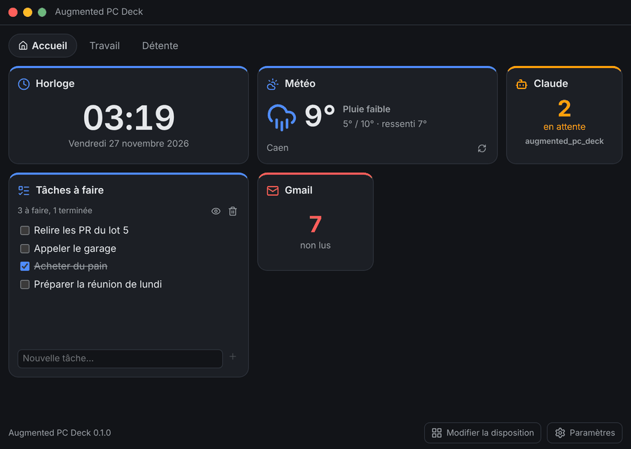

# Augmented PC Deck

[](https://github.com/MartinVoron/augmented_pc_deck/releases/latest)
[](https://github.com/MartinVoron/augmented_pc_deck/releases)
[](https://github.com/MartinVoron/augmented_pc_deck/actions/workflows/ci.yml)

**[⬇ Télécharger pour Windows ou Linux](https://github.com/MartinVoron/augmented_pc_deck/releases/latest)**
· [Guide d'installation et de mise en place](docs/installation.md)

Tableau de bord de bureau, en local, pour Windows, façon Stream Deck : raccourcis
d'applications, gestionnaire de tâches, minuteurs, liste de tâches, musique en cours,
GitHub, Gmail et notifications de Claude Code.

Construit avec [Tauri 2](https://v2.tauri.app/) (Rust) et [Svelte 5](https://svelte.dev/)
(TypeScript, Vite).



## Installer l'application

Pour simplement utiliser l'application, pas besoin de la compiler :

1. Ouvrir la [dernière version](https://github.com/MartinVoron/augmented_pc_deck/releases/latest)
   et, dans **Assets**, télécharger le fichier `…_x64-setup.exe` (conseillé) ou le `.msi`.
2. Le lancer. Si Windows affiche « Windows a protégé votre ordinateur » (l'installateur
   n'est pas signé) : **Informations complémentaires**, puis **Exécuter quand même**.
3. L'application apparaît dans le menu Démarrer (« Augmented PC Deck »).

**Sous Linux** (64 bits), dans la même page :

- Debian, Ubuntu, Linux Mint : télécharger le `.deb`, puis
  `sudo apt install ./Augmented.PC.Deck_X.Y.Z_amd64.deb` ;
- autres distributions : télécharger le `.AppImage`, le rendre exécutable
  (`chmod +x`), puis le lancer.

La version Linux est récente : quelques modules sont encore en cours de portage
(voir [le guide](docs/installation.md#sous-linux) et l'issue #77).

Le **[guide d'installation et de mise en place](docs/installation.md)** explique la suite,
module par module : raccourcis, minuteurs, tâches, musique, météo, pages, GitHub, Gmail et
notifications de Claude Code, ainsi que la mise à jour et la désinstallation.

Une nouvelle version est publiée à chaque fusion de la PR `version/vX.Y.Z` (voir
[CONTRIBUTING.md](CONTRIBUTING.md#6-versions)).

## Prérequis pour développer (Windows 10 ou 11)

1. **Microsoft C++ Build Tools** : installer
   [Visual Studio Build Tools](https://visualstudio.microsoft.com/fr/visual-cpp-build-tools/)
   et cocher « Développement Desktop en C++ ».
2. **WebView2** : déjà présent sous Windows 10 (version 1803 et plus) et Windows 11.
   Sinon, installer le [runtime WebView2](https://developer.microsoft.com/fr-fr/microsoft-edge/webview2/).
3. **Rust** (version 1.77.2 ou plus) : installer avec [rustup](https://rustup.rs/), en
   gardant la chaîne `stable-msvc` proposée par défaut.
4. **Node.js** (version 20.19 ou plus, la version LTS conseillée) : [nodejs.org](https://nodejs.org/fr).

**Sous Linux** (Debian, Ubuntu), Rust et Node.js comme ci-dessus, plus les bibliothèques
de Tauri :

```sh
sudo apt install libwebkit2gtk-4.1-dev libgtk-3-dev libayatana-appindicator3-dev \
  librsvg2-dev libdbus-1-dev libssl-dev build-essential
```

Le détail officiel est sur la page [Prérequis de Tauri](https://v2.tauri.app/start/prerequisites/).

## Démarrer

```sh
git clone https://github.com/MartinVoron/augmented_pc_deck.git
cd augmented_pc_deck
git config core.hooksPath .githooks
npm install
```

## Commandes

| Commande              | Ce qu'elle fait                                                  |
|-----------------------|------------------------------------------------------------------|
| `npm run tauri dev`   | Lance l'application en mode développement (rechargement à chaud) |
| `npm run tauri build` | Produit l'exécutable et les installateurs (Windows ou Linux)     |
| `npm run check`       | Vérifie les types TypeScript et Svelte                           |
| `npm test`            | Lance tous les tests : interface (Vitest) puis Rust (`cargo test`) |
| `npm run lint`        | Vérifie le style : ESLint, Prettier, `cargo fmt` et `cargo clippy` |
| `npm run format`      | Met en forme tout le code (Prettier et `cargo fmt`)              |
| `npm run build`       | Compile seulement l'interface (dossier `dist/`)                  |

Après `npm run tauri build`, on trouve :

- l'exécutable : `src-tauri/target/release/augmented-pc-deck.exe` ;
- les installateurs : `src-tauri/target/release/bundle/nsis/` et `bundle/msi/` ;
- sous Linux : `bundle/deb/` et `bundle/appimage/` (réglages propres à Linux dans
  `src-tauri/tauri.linux.conf.json`).

La première compilation Rust prend quelques minutes, les suivantes sont bien plus rapides.

## Organisation du code

Chaque fonctionnalité a sa place, côté Rust et côté interface, avec le même nom anglais :
`launcher` (lanceur), `processes` (processus), `timers` (minuteurs), `todos` (tâches),
`music` (musique), `github`, `gmail`, `claude` et `settings` (paramètres).

```
src/
  App.svelte              écran principal
  lib/tauri.ts            fonction call() pour appeler le Rust
  lib/notifications.ts    envoi des notifications Windows
  lib/theme.css           palette du thème sombre (variables CSS)
  lib/grid/               tailles, icônes et disposition par défaut des tuiles
  lib/components/         composants communs : grille, tuile, protection des tuiles
  lib/modules/<module>/   composants et appels Tauri d'un module
src-tauri/
  src/error.rs            erreur commune renvoyée à l'interface
  src/notifications.rs    service commun des notifications Windows
  src/modules/<module>.rs commandes Tauri d'un module
  tauri.conf.json         configuration de la fenêtre et de l'installateur
public/                   fichiers statiques de l'interface
```

### Convention pour les commandes Tauri

- Côté Rust, une commande s'appelle `<module>_<action>` (par exemple `timers_start`),
  renvoie toujours un `AppResult<T>` et est déclarée dans `src-tauri/src/lib.rs`.
- En cas d'échec, l'interface reçoit `{ "code": "not_found", "message": "…" }` :
  le `code` est stable pour le code, le `message` est en français, prêt à afficher.
- Côté interface, on n'utilise jamais `invoke` directement mais `call()` de
  `src/lib/tauri.ts`, qui transforme l'échec en `AppError` (avec `code` et `message`).

## Configuration

Les réglages et la disposition des tuiles sont enregistrés dans
`%APPDATA%\fr.martinvoron.augmented-pc-deck\config.json`.

- Le fichier porte un numéro `version`. Quand son format change, l'application migre
  l'ancien fichier au démarrage (voir `src-tauri/src/modules/settings/config.rs`).
- Si le fichier est abîmé (ou vient d'une version plus récente), il est mis de côté sous
  le nom `config.json.<horodatage>.bak` et l'application démarre avec les valeurs par défaut.

## Fenêtre

- La taille, la position et l'écran de la fenêtre sont retenus d'un lancement à l'autre
  (pratique pour la laisser sur un second écran).
- Paramètres > Général > Fenêtre : « Toujours au premier plan » et « Plein écran ».
- Paramètres > Général > Démarrage : « Lancer au démarrage de Windows ».
- La barre de titre de Windows est remplacée par une barre sombre avec trois ronds :
  rouge pour fermer, jaune pour réduire, vert pour agrandir. On déplace la fenêtre en
  la tenant par cette barre, et un double-clic l'agrandit.
- Fermer (rond rouge ou Alt+F4) ne quitte pas l'application : la fenêtre se cache dans
  la zone de notification.
- L'icône dans la zone de notification propose Afficher, Masquer et Quitter ;
  un clic sur l'icône affiche la fenêtre. Pour arrêter vraiment l'application, utiliser
  Quitter.

## Jetons de connexion

Les jetons GitHub, Gmail et Claude ne sont jamais écrits dans un fichier de l'application
ni dans le journal. Ils sont rangés dans le **Gestionnaire d'identification Windows**
(Panneau de configuration > Gestionnaire d'identification > Informations d'identification
Windows), sous le nom `augmented-pc-deck`. Sous Linux, ils vont dans le trousseau du
bureau (Secret Service : GNOME Keyring, KWallet…). L'interface peut enregistrer ou supprimer un
jeton, mais jamais le relire : seul le Rust s'en sert (`src-tauri/src/tokens.rs`).

## Journal des erreurs

Les messages de l'application et les erreurs (Rust et interface) sont écrits dans
`%LOCALAPPDATA%\fr.martinvoron.augmented-pc-deck\logs\augmented-pc-deck.log`.
Au-delà de 1 Mo, le fichier est archivé et un nouveau commence ; les 5 derniers sont gardés.

Pour qu'une tuile en panne ne fasse pas planter l'application, son contenu est placé dans
le composant `TileBoundary` (`src/lib/components/TileBoundary.svelte`) : l'erreur est écrite
dans le journal et la tuile affiche un message clair avec un bouton « Réessayer ».

## Tests

- **Interface** : fichiers `*.test.ts` à côté du code testé (exemples : `src/lib/tauri.test.ts`,
  `src/App.test.ts`). Ils tournent avec Vitest et Testing Library, sans Tauri : on remplace
  `invoke` par une fausse fonction avec `vi.mock`. `npm run test:front` les lance seuls.
- **Rust** : un bloc `#[cfg(test)] mod tests` à la fin du fichier testé (exemple :
  `src-tauri/src/error.rs`). `npm run test:rust` les lance seuls.

## Intégration continue

À chaque PR, le workflow [CI](.github/workflows/ci.yml) vérifie le projet sous Windows et
sous Linux (Ubuntu 22.04) : `npm run lint`, `npm run check`, les tests de l'interface et
du Rust, puis la compilation de l'application avec ses installateurs. Il échoue dès qu'une
étape échoue. Les installateurs produits sont joints à la vérification (artefacts
`installateurs-windows` et `paquets-linux`, gardés 14 jours) : on peut les essayer avant
de fusionner. Les dépendances npm et la
compilation Rust sont mises en cache pour aller plus vite.

## Contribuer

Les règles de travail (issues, branches, commits en français, PR) sont dans
[CONTRIBUTING.md](CONTRIBUTING.md).

## Licence

[MIT](LICENSE)
