# Guide d'installation et de mise en place

Ce guide explique, pas à pas, comment installer Augmented PC Deck sous Windows ou sous
Linux, puis régler chaque module. Comptez 5 minutes pour l'installation et les modules simples, et
environ 15 minutes de plus si vous voulez GitHub, Gmail et Claude Code.

Sommaire :

1. [Télécharger et installer](#1-télécharger-et-installer)
2. [Premiers pas : pages, tuiles et paramètres](#2-premiers-pas--pages-tuiles-et-paramètres)
3. [Réglages généraux](#3-réglages-généraux)
4. [Raccourcis (lanceur)](#4-raccourcis-lanceur)
5. [Processeur et mémoire](#5-processeur-et-mémoire)
6. [Minuteurs, chronomètre et Pomodoro](#6-minuteurs-chronomètre-et-pomodoro)
7. [Tâches](#7-tâches)
8. [Musique](#8-musique)
9. [Horloge et météo](#9-horloge-et-météo)
10. [GitHub](#10-github)
11. [Gmail](#11-gmail)
12. [Notifications de Claude Code](#12-notifications-de-claude-code)
13. [Mettre à jour, désinstaller](#13-mettre-à-jour-désinstaller)
14. [En cas de problème](#14-en-cas-de-problème)

## 1. Télécharger et installer

Il faut Windows 10 ou 11 (64 bits).

1. Ouvrez la page de la
   [dernière version](https://github.com/MartinVoron/augmented_pc_deck/releases/latest).
2. Dans la partie **Assets**, téléchargez le fichier qui finit par **`_x64-setup.exe`**
   (par exemple `Augmented.PC.Deck_0.1.0_x64-setup.exe`).
   - Le `.msi` fait la même chose, mais installe pour tous les comptes du PC et demande
     les droits administrateur. Prenez le `.exe` si vous hésitez.
3. Lancez le fichier téléchargé.
4. Windows peut afficher **« Windows a protégé votre ordinateur »** : l'installateur n'est
   pas signé (un certificat coûte cher pour un projet perso). Cliquez sur
   **Informations complémentaires**, puis sur **Exécuter quand même**.
5. Suivez l'installateur (en français). Il n'a pas besoin des droits administrateur.
   Si WebView2 manque (rare sur Windows 10 et 11), il l'installe tout seul.
6. À la fin, lancez l'application, ou retrouvez-la plus tard dans le **menu Démarrer** :
   « Augmented PC Deck ».

### Sous Linux

Il faut une distribution 64 bits récente (par exemple Ubuntu 22.04 ou plus, Debian 12,
Fedora 38). Dans la partie **Assets** de la
[dernière version](https://github.com/MartinVoron/augmented_pc_deck/releases/latest) :

- **Debian, Ubuntu, Linux Mint, Pop!_OS** : téléchargez le fichier qui finit par
  **`_amd64.deb`**, puis installez-le depuis le dossier de téléchargement :

  ```sh
  sudo apt install ./Augmented.PC.Deck_0.2.0_amd64.deb
  ```

  (remplacez le numéro par celui du fichier). L'application apparaît dans le menu des
  applications.
- **Autres distributions** (Fedora, Arch…) : téléchargez le fichier **`.AppImage`**,
  rendez-le exécutable puis lancez-le :

  ```sh
  chmod +x Augmented.PC.Deck_0.2.0_amd64.AppImage
  ./Augmented.PC.Deck_0.2.0_amd64.AppImage
  ```

La version Linux est récente : quelques modules sont encore en cours de portage. Chaque
section ci-dessous le précise, et l'avancement est suivi dans
l'[issue #77](https://github.com/MartinVoron/augmented_pc_deck/issues/77).

## 2. Premiers pas : pages, tuiles et paramètres

L'écran est une grille de **tuiles**, rangées en **pages** (les onglets en haut).
L'application s'ouvre toujours sur la page **Accueil**.

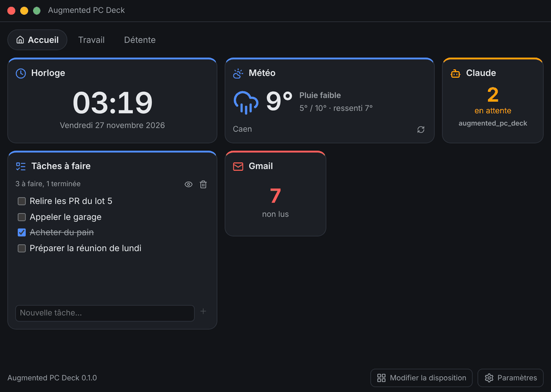

En bas de la fenêtre, deux boutons :

- **Modifier la disposition** : passe en mode édition. Vous pouvez alors :
  - ajouter une tuile (**Ajouter une tuile** : choisir le module, puis **Ajouter**) ;
  - changer sa taille : petite (1×1), large (2×1) ou grande (2×2) ;
  - la déplacer (glisser, ou flèches avant/après) et la supprimer ;
  - régler certaines tuiles : **Raccourcis…** pour le lanceur, **Ville…** pour la météo,
    « Afficher les secondes » pour l'horloge.

  Cliquez sur **Terminé** pour sortir du mode édition. Tout est enregistré tout de suite.

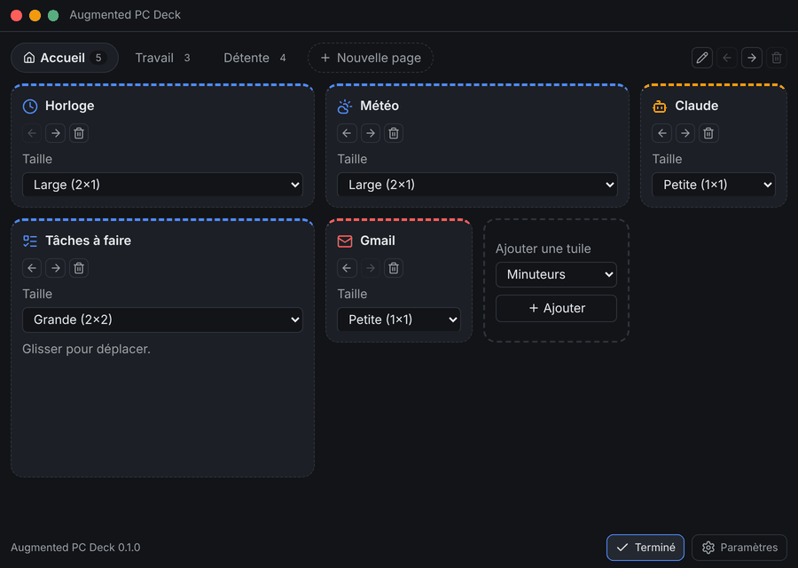
- **Paramètres** : les réglages de l'application et des comptes (GitHub, Gmail, Claude).

**Pages** : le bouton **Nouvelle page** à côté des onglets crée une page, vide ou à partir d'un modèle :

| Modèle        | Tuiles                                           |
| ------------- | ------------------------------------------------ |
| Travail       | GitHub, Gmail, Claude, tâches et raccourcis      |
| Système       | processeur et mémoire, minuteurs et raccourcis   |
| Détente       | musique, horloge et météo                        |
| Concentration | minuteurs (Pomodoro), tâches et horloge          |
| Page vide     | rien : ajoutez vos tuiles une à une              |

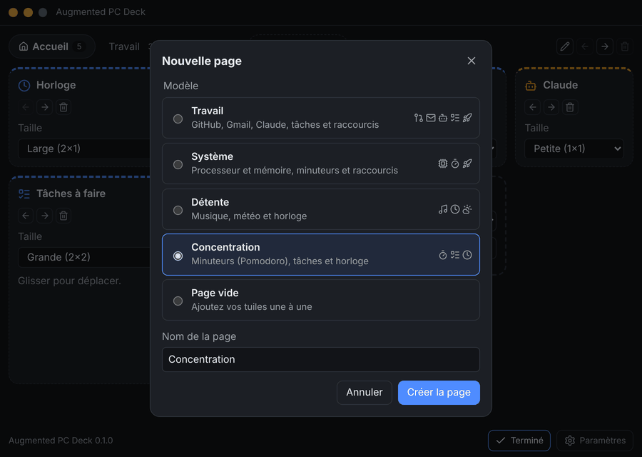

En mode édition, les boutons à droite des onglets renomment (crayon), déplacent (flèches)
et suppriment (corbeille) la page affichée. L'Accueil ne peut pas être supprimé.

**Fenêtre** : la barre du haut sert à déplacer la fenêtre (double-clic pour l'agrandir).
Le rond rouge **cache** l'application dans la zone de notification (à côté de l'horloge
de Windows) au lieu de la quitter, pour que minuteurs et notifications continuent. Pour
la quitter vraiment : clic droit sur son icône, puis **Quitter**.

Sous Linux, l'icône est dans la barre du haut ou du bas selon le bureau, et un clic ouvre
directement son menu (Afficher, Masquer, Quitter). Sous GNOME (Ubuntu l'inclut déjà), il
faut l'extension « AppIndicator » pour voir l'icône.

## 3. Réglages généraux

**Paramètres > Général** :

- **Toujours au premier plan** et **Plein écran** : pratique sur un second écran ou une
  petite tablette posée à côté du clavier. La taille et la position de la fenêtre sont
  retenues automatiquement.
- **Lancer à l'ouverture de la session** : l'application s'ouvre à chaque ouverture de
  session.
- **Afficher les notifications**, et **Envoyer une notification d'essai** pour
  vérifier qu'elles arrivent. Si rien ne s'affiche, regardez dans les paramètres de
  Windows : Système > Notifications > Augmented PC Deck.

Sous Linux, le lancement à l'ouverture de la session ajoute un fichier
`.desktop` dans `~/.config/autostart`. Les notifications s'affichent dans le
centre de notifications du bureau, avec les sons du thème du bureau (si votre bureau joue
les sons des notifications). Si rien ne s'affiche, vérifiez le mode Ne pas déranger.

## 4. Raccourcis (lanceur)

La tuile **Raccourcis** lance en un clic un programme, un fichier, un dossier ou un site.

1. Le plus simple : **glissez** un programme, un fichier ou un dossier depuis
   l'Explorateur (ou le Bureau) sur la tuile.
2. Ou cliquez sur **Ajouter un raccourci** (tuile vide), ou sur **Raccourcis…** en mode
   édition, puis **Nouveau raccourci** :
   - **Nom** : ce qui s'affiche sous l'icône ;
   - **Cible** : le chemin du programme, du fichier ou du dossier (bouton pour le choisir),
     ou une adresse `https://…` ;
   - **Icône personnalisée…** (facultatif) : une image à la place de l'icône d'origine ;
   - **Arguments de lancement** (facultatif, seulement pour un programme), par exemple
     `--profile-directory="Profile 1"` pour un profil Chrome.
3. Dans la même fenêtre, on peut modifier, réordonner (monter/descendre) ou supprimer
   les raccourcis.

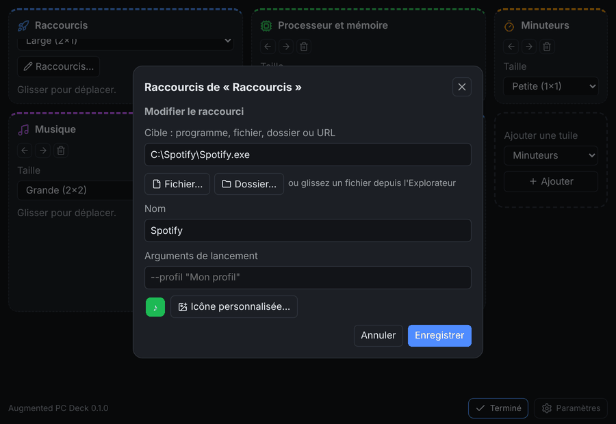

Sous Linux :

- pour une application installée, choisissez son fichier `.desktop`, dans
  `/usr/share/applications` (ou `~/.local/share/applications`, et
  `/var/lib/flatpak/exports/share/applications` pour Flatpak). La tuile lance
  l'application et affiche son icône ;
- un fichier exécutable (programme, script, `.AppImage`) est lancé directement, avec ses
  arguments ;
- les adresses, fichiers et dossiers s'ouvrent avec l'application associée.

Chaque tuile Raccourcis a sa propre liste : vous pouvez en mettre une par page (outils
de travail, jeux, dossiers…). Si une cible a été déplacée ou supprimée, la tuile le dit
clairement au clic.

## 5. Processeur et mémoire

Rien à régler. La tuile affiche l'usage du processeur, de la mémoire et des disques,
mis à jour toutes les 2 secondes.

**Voir les processus** ouvre la liste des programmes en cours, triable et filtrable par
nom. **Arrêter** termine un programme bloqué (une confirmation est demandée).

Sous Linux, la liste des disques peut encore montrer des disques virtuels, par exemple
ceux des paquets Snap ([#84](https://github.com/MartinVoron/augmented_pc_deck/issues/84)).

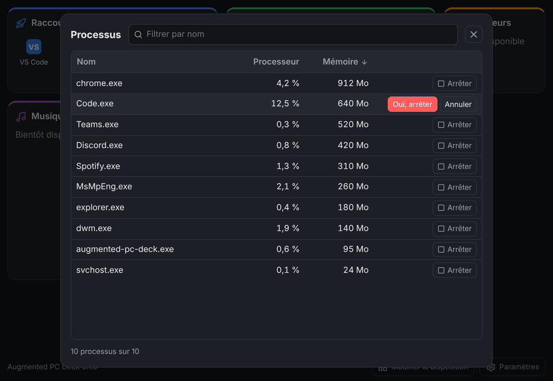

## 6. Minuteurs, chronomètre et Pomodoro

La tuile **Minuteurs** a trois onglets :

- **Minuteurs** (comptes à rebours) : **Nouveau minuteur**, un nom (« Thé », « Lessive »…)
  et une durée, ou une durée toute prête. Plusieurs minuteurs peuvent tourner en même
  temps. Une notification prévient à la fin.
- **Chronomètre** : démarrer, mettre en pause, noter des tours, remettre à zéro.
- **Pomodoro** : alternance travail et pause. Le bouton de réglage permet de choisir les
  durées (travail, pause, longue pause) et le nombre de séances avant la longue pause.
  Une notification annonce chaque changement de phase.

Les minuteurs continuent quand la fenêtre est cachée dans la zone de notification.

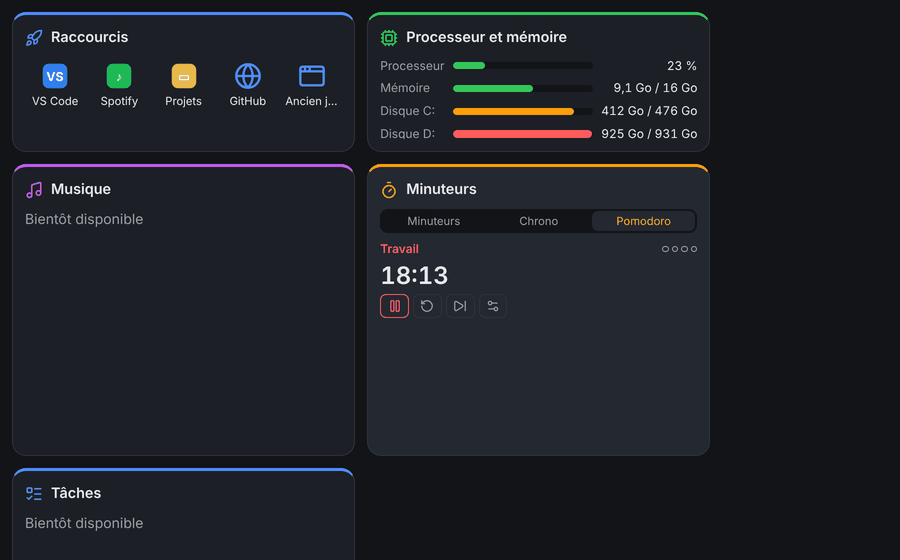

## 7. Tâches

Tapez dans **Nouvelle tâche…** puis Entrée. Cochez une tâche pour la terminer ;
double-clic (ou crayon) pour la modifier ; flèches pour la monter ou la descendre.
Les tâches terminées peuvent être masquées ou supprimées d'un coup. Tout est enregistré
tout de suite.

## 8. Musique

Rien à régler. La tuile montre le morceau en cours (titre, artiste, pochette,
progression) et propose lecture/pause, précédent et suivant.

Elle marche avec toute application qui s'affiche dans le contrôle du volume de Windows :
Spotify, Deezer, YouTube dans Edge ou Chrome, le lecteur multimédia de
Windows, etc. Un bouton grisé veut dire que l'application ne le propose pas.

Sous Linux, elle marche avec tout lecteur compatible MPRIS, c'est-à-dire ceux qui
s'affichent dans le panneau média du bureau : Spotify, Firefox, Chrome, VLC, Rhythmbox,
Elisa… S'il y en a plusieurs, la tuile montre celui qui joue.

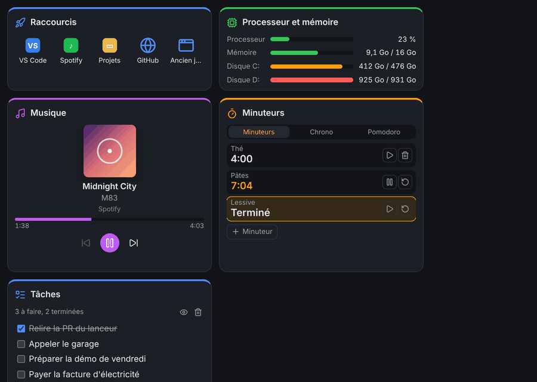

## 9. Horloge et météo

- **Horloge** : l'heure et la date. En mode édition, cochez « Afficher les secondes » si
  vous les voulez.
- **Météo** : température, temps du jour et, en grande taille, les prochains jours.
  En mode édition, cliquez sur **Ville…**, tapez le nom de votre ville puis choisissez-la
  dans la liste (Caen par défaut). Les données viennent d'[Open-Meteo](https://open-meteo.com/),
  gratuit et sans compte. Mise à jour toutes les 30 minutes, ou avec le bouton
  d'actualisation.

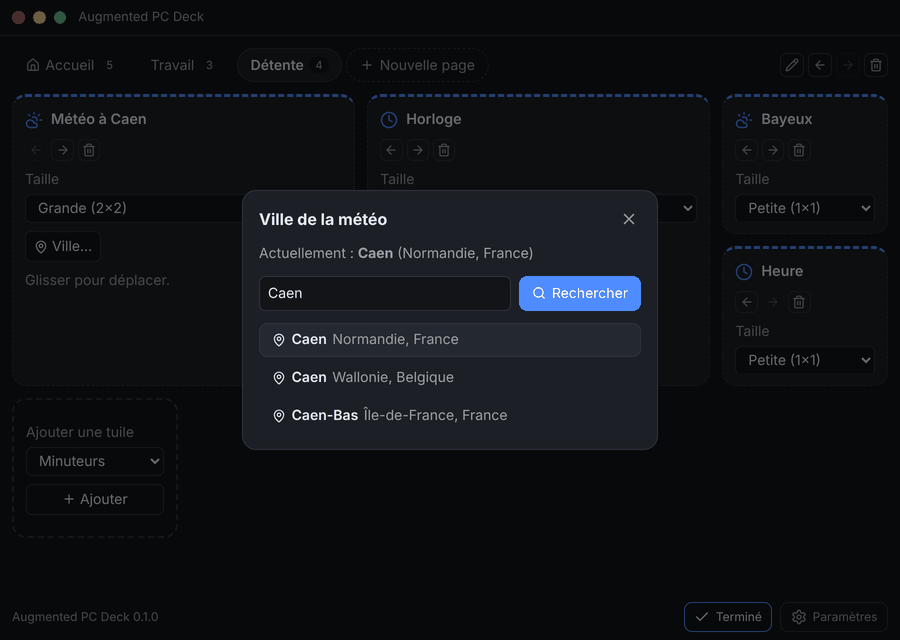

## 10. GitHub

La tuile **GitHub** affiche les PR à relire, vos PR ouvertes, les issues qui vous sont
assignées et vos notifications non lues. Il faut un **jeton personnel** GitHub.

1. **Paramètres > GitHub**, puis **Créer un jeton sur GitHub** : la page de GitHub s'ouvre
   avec les bons droits déjà cochés (**repo** et **notifications**).
2. Sur GitHub, choisissez une durée de validité (**Expiration**), puis
   **Generate token** en bas de la page.
3. Copiez le jeton (il commence par `ghp_`), collez-le dans l'application et cliquez sur
   **Se connecter**. Votre compte s'affiche.
4. Dans **Activité**, réglez la fréquence d'actualisation (en minutes).

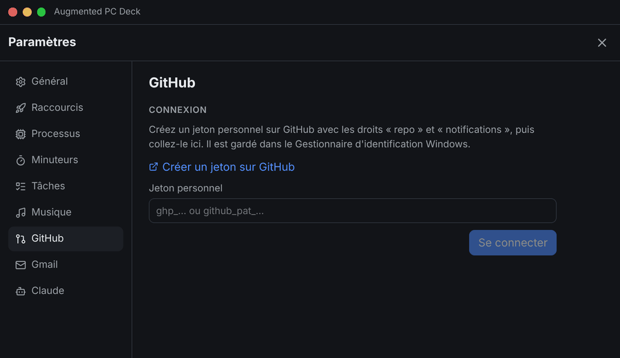

Le jeton est rangé dans le Gestionnaire d'identification Windows, jamais dans un fichier.
Quand il expire, la tuile le signale : créez-en un nouveau et recommencez l'étape 3.

Sous Linux, les jetons (GitHub, Gmail, Claude) sont rangés dans le trousseau du bureau
(GNOME Keyring, KWallet…), visible par exemple dans l'application « Mots de passe et clés »
(Seahorse), sous le nom `augmented-pc-deck`. Si l'application dit qu'elle ne peut pas
enregistrer le jeton, vérifiez qu'un trousseau est installé et déverrouillé.

## 11. Gmail

La tuile **Gmail** affiche le nombre d'e-mails non lus et les derniers messages, et peut
envoyer une notification pour chaque nouvel e-mail. L'accès est **en lecture seule**.

Google demande de créer, une seule fois, votre propre identifiant OAuth (gratuit, environ
10 minutes). Le guide détaillé est ici : **[Connecter Gmail](gmail-oauth.md)**. En résumé :

1. Créer un projet sur la [console Google Cloud](https://console.cloud.google.com/).
2. Activer l'API Gmail.
3. Configurer l'écran de consentement et vous ajouter comme utilisateur test.
4. Créer un identifiant OAuth de type **Application de bureau**.
5. Dans **Paramètres > Gmail**, coller l'**ID client** et le **code secret du client**,
   puis **Se connecter avec Google**.

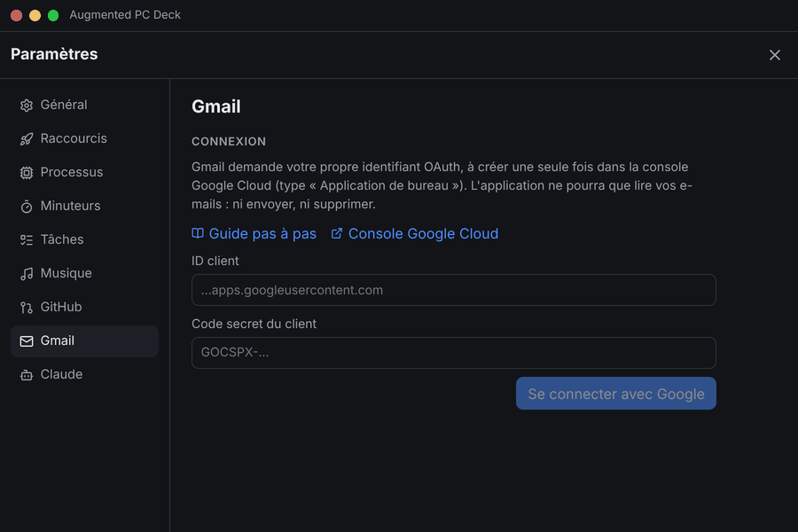

À savoir : tant que l'application Google reste en mode « Test », Google demande de se
reconnecter tous les 7 jours (bouton **Se reconnecter**, rien d'autre à refaire).

## 12. Notifications de Claude Code

La tuile **Claude** vous prévient quand Claude Code attend une réponse ou a fini une
tâche. Il faut ajouter un petit réglage à Claude Code, une seule fois. Le guide détaillé
est ici : **[Recevoir les notifications de Claude Code](claude-hook.md)**. En résumé :

1. **Paramètres > Claude** : vérifier que le serveur local est « À l'écoute ».
2. **Créer le script**, puis **Copier le bloc**.
3. Coller le bloc dans `%USERPROFILE%\.claude\settings.json` (le créer s'il n'existe pas).
4. Redémarrer Claude Code.

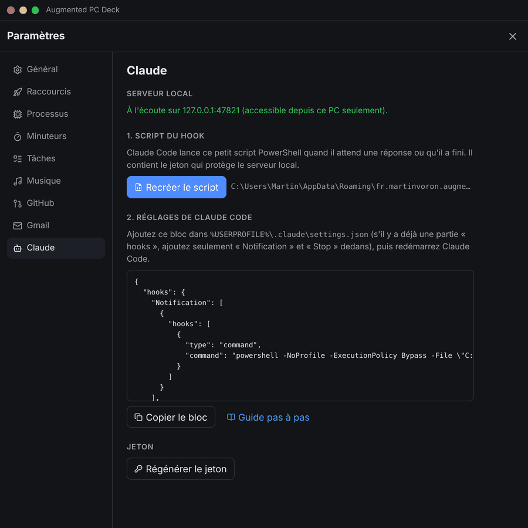

Sous Linux, c'est pareil : le script est un script `sh` qui utilise `curl`, et le
fichier des réglages est `~/.claude/settings.json`.

## 13. Mettre à jour, désinstaller

- **Mettre à jour** : téléchargez la nouvelle version (étape 1) et installez-la
  par-dessus l'ancienne. Vos pages, tuiles, réglages et connexions sont gardés.
  Le numéro de version installé s'affiche en bas à gauche de la fenêtre.
- **Désinstaller** : Paramètres de Windows > Applications > Applications installées >
  Augmented PC Deck > Désinstaller. Désactivez d'abord **Lancer à l'ouverture de
  la session**, sinon une entrée vide reste dans les applications de démarrage. Cochez
  « Supprimer les données de l'application » pour tout effacer.

Où sont vos données :

- réglages, pages et tuiles : `%APPDATA%\fr.martinvoron.augmented-pc-deck\config.json` ;
- jetons GitHub, Gmail et Claude : Gestionnaire d'identification Windows, entrées
  `augmented-pc-deck` (sous Linux : trousseau du bureau) ;
- journal des erreurs : `%LOCALAPPDATA%\fr.martinvoron.augmented-pc-deck\logs\`.

Sous Linux :

- **Mettre à jour** : installez le nouveau `.deb` de la même façon, ou remplacez
  l'ancien `.AppImage` par le nouveau.
- **Désinstaller** : `sudo apt remove augmented-pc-deck` pour le `.deb`, ou supprimez le
  fichier `.AppImage`. Désactivez d'abord **Lancer à l'ouverture de la session**.
- Réglages : `~/.config/fr.martinvoron.augmented-pc-deck/config.json` ; journal :
  `~/.local/share/fr.martinvoron.augmented-pc-deck/logs/`.

## 14. En cas de problème

- **Rien ne se passe au lancement** : l'application est peut-être déjà ouverte et cachée.
  Cliquez sur son icône dans la zone de notification (flèche ^ à côté de l'horloge).
  Sous Linux, si l'icône n'apparaît pas, voir la fin de la section 2.
- **Pas de notifications** : Paramètres > Général > Envoyer une notification d'essai, puis
  vérifiez les réglages de notifications de Windows et le mode Ne pas déranger.
- **La tuile GitHub ou Gmail dit de se reconnecter** : le jeton a expiré ou a été retiré ;
  voir les sections 10 et 11.
- **Autre souci** : ouvrez une [issue](https://github.com/MartinVoron/augmented_pc_deck/issues)
  en joignant le dernier fichier du journal.
